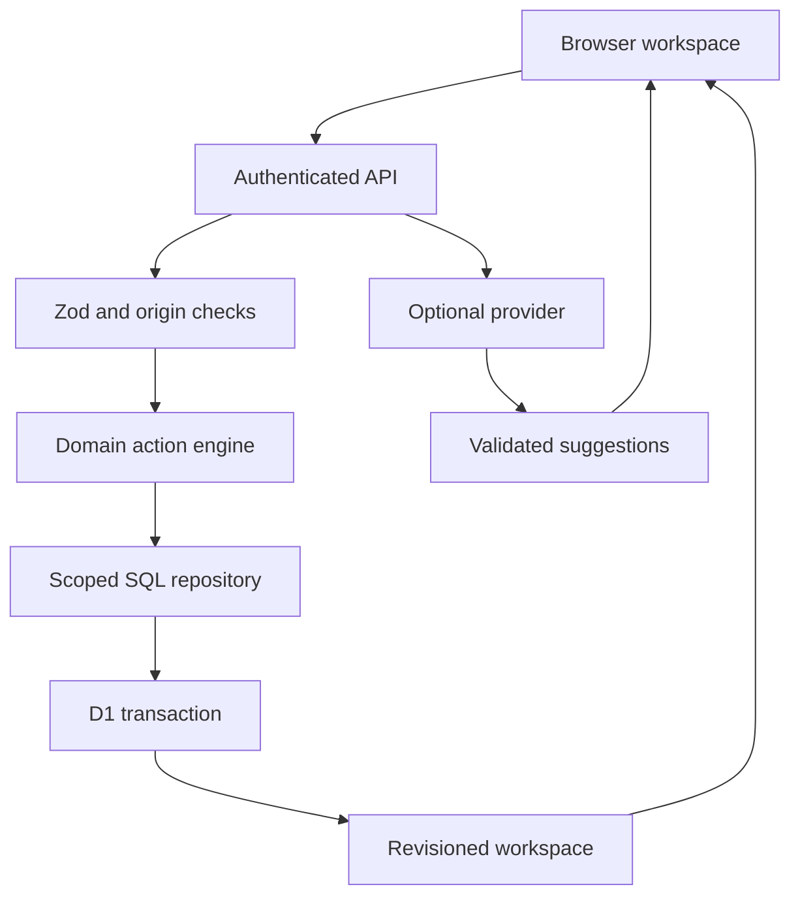
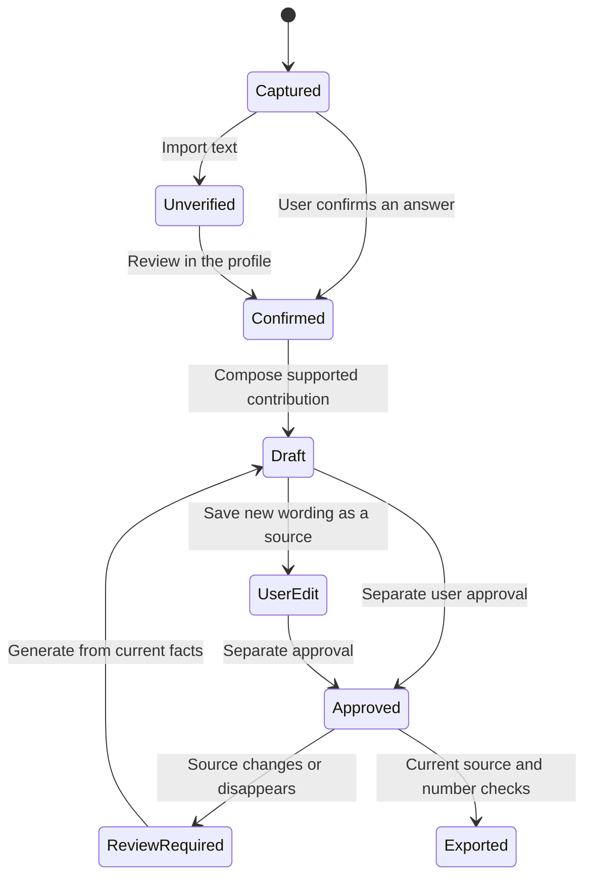

# Architecture

## Stack and tradeoffs

| Layer                 | Implementation                                                     | Reason                                                                       |
| --------------------- | ------------------------------------------------------------------ | ---------------------------------------------------------------------------- |
| Routes and UI         | TypeScript, React 19, Next App Router conventions                  | Typed shared contracts and familiar component structure                      |
| Sites runtime         | Vinext/Vite and Cloudflare Workers                                 | Required platform adapter; `sites()` generates the deployment contract       |
| UI components         | Tailwind 4, shadcn/Radix, Lucide                                   | Accessible form/dialog primitives with a custom visual system                |
| Form and server state | React Hook Form, Zod, TanStack Query                               | Explicit validation, async errors, loading state and one authoritative cache |
| Database              | D1/SQLite with Drizzle schema/migrations                           | Relational ownership/provenance; deployable within Sites                     |
| PDF                   | pdf-lib + fontkit, locally embedded DejaVu fonts                   | Selectable text, measured wrapping, pagination and no screenshot export      |
| 3D                    | Lazy-loaded Three.js                                               | Direct control over resource cleanup and progressive fallback                |
| Providers             | Explicit AIProvider, OccupationProvider and JobProvider interfaces | Core works with rules/authored data; credentials remain server-side          |
| Tests                 | Node test runner and node:sqlite                                   | Fast pure-domain checks and real SQL/migration coverage                      |

The platform currently supplies `vinext@1.0.0-beta.5`. This is an intentional platform compatibility choice rather than a claim that every dependency is a stable general-purpose framework release. The lockfile and prescribed build wrapper make the delivered environment reproducible. Large lazy PDF/Three.js bundles produce a build size warning; they load only when needed.

## Request flow

`components/folio` owns presentation; `lib/engine` owns deterministic behavior. `lib/providers` contains replaceable integrations. `lib/repository.ts` receives a D1 handle so tests can exercise its actual SQL without importing the Worker environment. `lib/store.ts` supplies the runtime database. Route handlers never trust a client-supplied account identity.

## Data model

| Table          | Key / relationship                           | Purpose                                                               |
| -------------- | -------------------------------------------- | --------------------------------------------------------------------- |
| profiles       | `id`; indexed `user_id`                      | A user's demo or personal profile, workspace revision and write token |
| entities       | `(profile_id, id)` → profile                 | Repeatable work, project, activity and additional-education entries   |
| facts          | `(profile_id, id)` → profile                 | Question scope, original words, confirmation and source revision      |
| resumes        | `(profile_id, id)` → profile                 | Named version metadata and frozen presentation snapshot               |
| bullets        | `(profile_id, id)` → profile                 | Ordered résumé statements and approval state                          |
| bullet_sources | `(profile_id, bullet_id, fact_id)` → profile | Claim-to-answer links and source revision at generation               |
| resume_history | `(profile_id, id)` → profile                 | Bounded immutable previous versions                                   |
| saved_jobs     | `(profile_id, job_id)` → profile             | Shortlist membership                                                  |
| ai_operations  | `id`; `(user_id, created_at)` index          | Minimal paid-provider rate-limit metadata                             |

All profile child tables cascade on profile deletion. Source IDs deliberately do not cascade when an individual fact is removed: history must retain the reference so the interface can identify missing evidence and block stale exports. Separate row-level profile ownership prevents reused fictional IDs from crossing accounts.

The generated migration is `drizzle/0000_friendly_fenris.sql`. The migration is applied explicitly, never created opportunistically in a request handler. Production packaging stages migrations with the Worker.

## Concurrent writes

Every mutation includes the workspace revision read by the browser. The server loads that user's current profile and rejects an already-stale request. In one D1 `batch` transaction, it:

1. Creates the profile if this is the first save.
2. Performs a compare-and-swap update conditioned on the expected revision, assigning a fresh write token.
3. Replaces the bounded child collections only when that exact token exists on the profile.
4. Rejects if the conditional update changed zero rows.

The token condition prevents the losing writer from deleting or inserting child records even if both requests passed the initial read. Values use prepared statements; SQL identifiers come only from a fixed internal list. `json_each` inserts bounded sets without a parameter per field. Tests run the generated migration and repository statements against real SQLite, including stale writes and tenant deletion.

For a larger service, replace full-collection writes with entity-level operations and indexes based on measured access patterns.

## API contract

| Endpoint                             | Method | Behavior                                                                                     |
| ------------------------------------ | ------ | -------------------------------------------------------------------------------------------- |
| `/api/workspace?mode=demo\|personal` | GET    | Return the authenticated user's workspace; fictional/empty seed when absent                  |
| `/api/workspace`                     | POST   | `{mode, revision, action}` validated by `RequestSchema`; return saved workspace              |
| `/api/workspace`                     | DELETE | `{confirm:"DELETE"}` deletes both modes and AI-operation metadata for this account           |
| `/api/ai`                            | POST   | `{mode, entityId}`; rules fallback or consented, rate-limited provider suggestions           |
| `/api/occupation?code=...`           | GET    | Fixed curated O*NET-SOC code lookup; live source when configured, curated fallback otherwise |

Actions are `profile`, `answer`, `entity`, `deleteEntity`, `deleteFact`, `generate`, `resume`, `deleteResume`, `restore`, `saveJob`, `import`, and `reset`. See `lib/validation.ts` for exact shapes and limits. POST identity always comes from Sites; no payload field can switch users. Responses use `no-store`. Cross-origin JSON mutation requests are rejected. Workspace payloads are bounded to 200,000 characters in addition to schema limits.

## Evidence and résumé versioning

An edited résumé statement is explicitly treated as a new user-supplied fact, not as an AI-inferred truth. It cannot keep approval from the previous text. A client cannot move a known bullet to a different entity, invent its provenance, or add a new unknown bullet ID. Numerical tokens must occur in linked confirmed sources. This is a structural check, not semantic proof.

Versions freeze contact/education, entity titles, and demonstrated skill names. Tailoring ranks existing grounded contributions against recognized terms in a pasted description; it never adds missing skills. The master fact collection is unchanged. Historical snapshots are capped at 40 per workspace; restoring a snapshot checks its source revisions again.

## Explainable matching

Career ranking uses `0.65 × demonstrated skill coverage + 0.25 × interest overlap + 0.10 × relevant enjoyed coursework/project`. We show connections, gaps, and authored labels rather than pretending the result is a psychometric probability. The weights are product judgments, not externally validated coefficients. Work-style questions are captured but not all currently influence the ranking.

Sample job ranking uses demonstrated skill matches, plus small transparent weights for role-title overlap, the profile's city, and work arrangement. Years mentioned are displayed, never interpreted as legal or professional eligibility. Matching operates on a bounded vocabulary, so users must review the original requirements.

## 3D and performance

The career graph lazy-imports Three.js, caps pixel ratio, limits animation to about 28 frames per second, pauses offscreen/hidden rendering, and disposes geometries, materials, observers and the renderer on unmount. Reduced-motion settings stop ambient rotation. Small screens, low-core devices and WebGL failure receive a native SVG fallback. Labeled HTML controls and a career list remain usable without WebGL. PDF/fontkit is loaded only on export.

## Trust boundaries and deployment

The production Worker trusts identity headers only because Sites strips and supplies them at its dispatcher. Do not expose the Worker directly on another host and trust arbitrary incoming identity headers. A different host needs a verified session implementation replacing `identity()`.

The `import.meta.env.DEV` identity is for local development only and is compiled out of production. No profile answers live in localStorage; only the selected demo/personal mode is stored there. Settings and all career data are persisted in D1. Provider secrets exist only in server environment bindings. React escapes answer text; links accept only HTTP(S), and provider URLs cannot be supplied by clients.
